# 2026最新Claude注册教程：从官网注册到首次使用一步到位

> 整理更新：2026-10-29。保留原稿操作配图；截图中的旧价格、邀请码和界面仅供参考，以当前页面为准。

## 本文目录

- [一、注册前的准备](#section-1)
- [二、Claude注册步骤（图文详解）](#section-2)
- [三、国内常用的接码服务](#section-3)
- [四、Claude注册常见问题（FAQ）](#section-4)
- [总结](#section-5)

在AI浪潮下，越来越多人开始用 Claude 来提升写作、编程和学习效率。很多新手第一次使用时会问：**Claude怎么注册？** 本文是一篇 2026 年最新的 Claude 注册图文教程，从进入官网到完成验证，一步步带你创建 Claude 账号。

## 一、注册前的准备

**确认所在地区**：Claude 仅在官方支持的国家和地区提供服务，注册前可以先查看官方支持地区列表：[https://www.anthropic.com/supported-countries](https://www.anthropic.com/supported-countries)

**准备一个常用邮箱**：Gmail、Outlook 等均可，用于接收登录链接。

准备一个接码平台：下面的文章有介绍两种接码方式

## 二、Claude注册步骤（图文详解）

### 1.进入官网 注册页面

搜索Claude进入官网页面，使用google或者apple账户进行注册，我们这里选择邮箱注册

传送门：[https://claude.ai/login](https://link.zhihu.com/?target=https%3A//claude.ai/login)

### 2.查看邮箱邮件

输入邮箱后，页面显示输入验证码，会给你发一封【Secure link to log in to Claude.ai】的邮件，记得去对应邮箱查看。

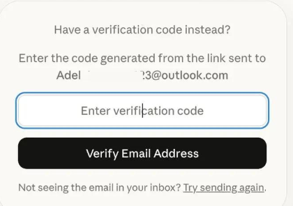

### 3.输入基本信息

按页面要求填写真实账户信息，阅读并确认条款后创建账户

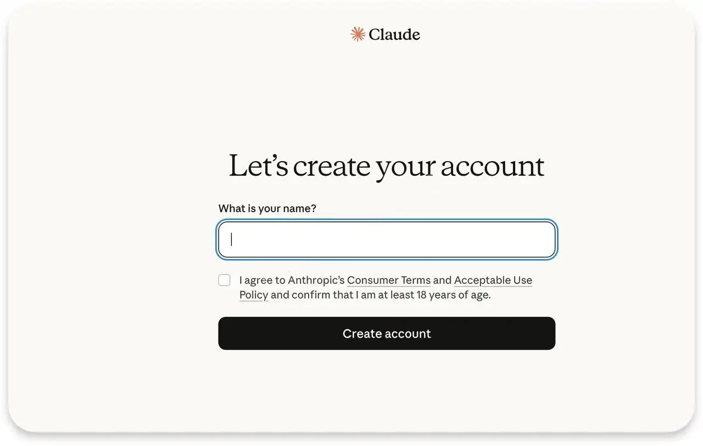

### 4.完成电话号码验证

若当前注册流程要求电话号码验证，请按官方页面提示提交支持且由本人长期控制的号码；不能把“美国号码”当作所有账号的统一要求。

这时候有同学要问了，我没有美国的电话号码怎么办？ 接着往下看

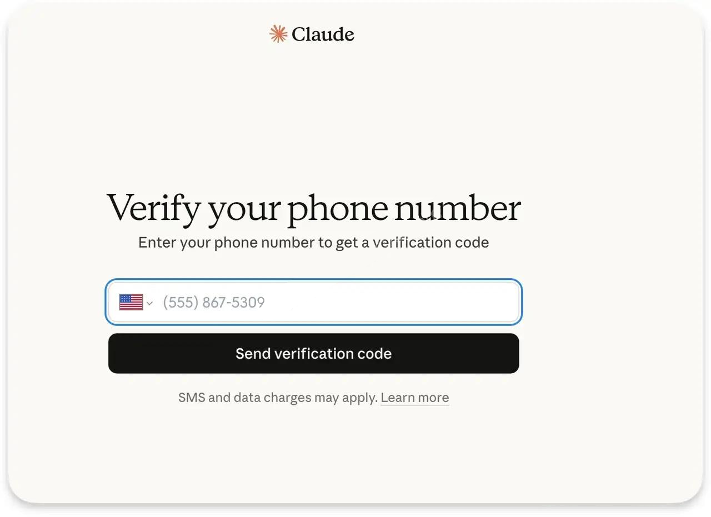

## 三、国内常用的接码服务

### 1.使用wildai服务

登录wildai官网,点击短信验证。

传送门：https://bewild.ai/?code=1103

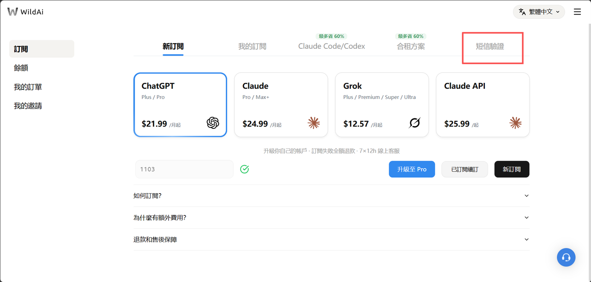

#### 1.1 点击购买账号

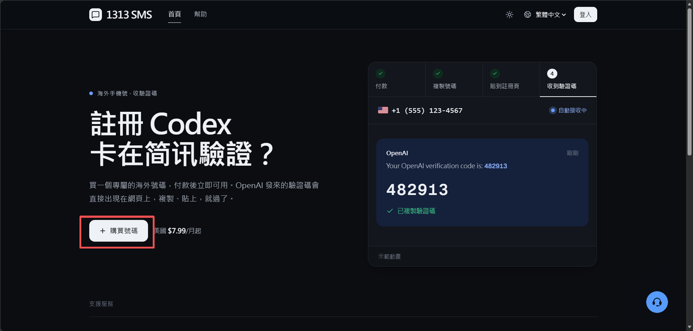

#### 1.2 进行套餐的选择

有多种套餐进行选择，根据自己所需进行选择

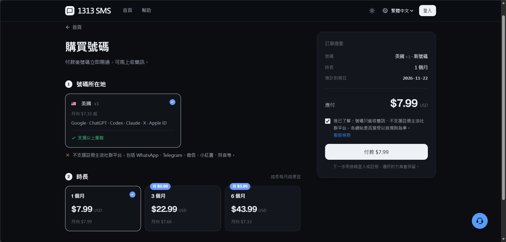

#### 1.3 选择付款方式

可以选择支付宝等国内支付平台进行支付

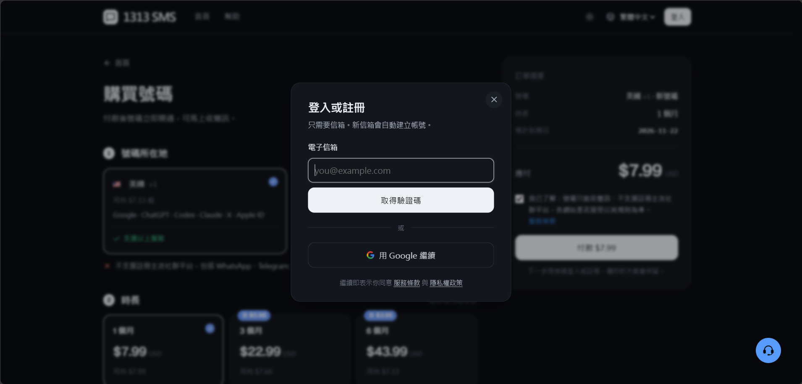

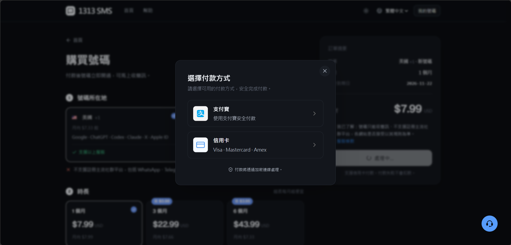

与HerSMS不同的是，号码有效期、支持服务和续费条件应以 WildAI 当前商品页为准，不应默认永久有效

### 2.使用HerSMS

#### 2.1登录HerSMS官网,点击接收短信

传送门:https://hero-sms-cn.com/

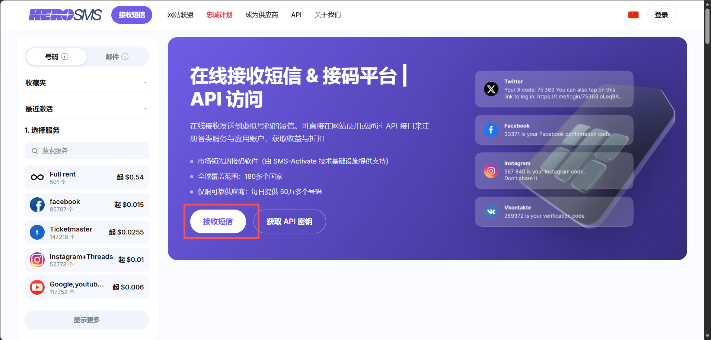

#### 2.2 选择国家 接收短信

在右侧选择服务中搜索claude，并且选择国家美国

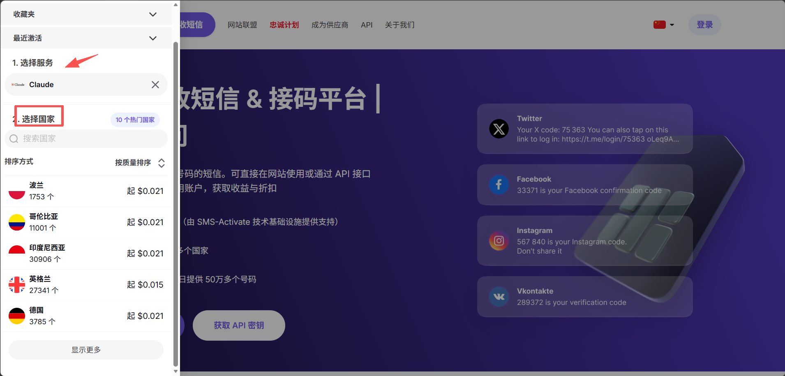

#### 2.3 选择使用时长，点击购买

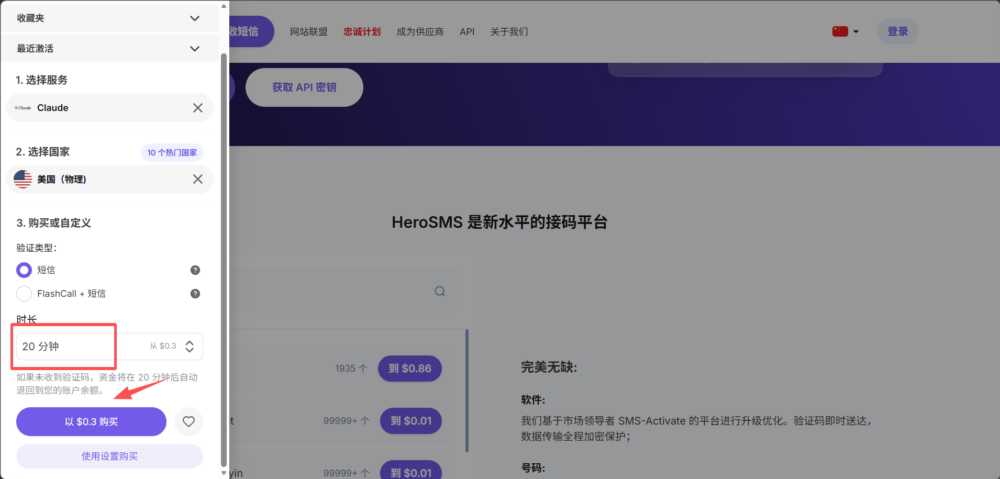

注：如果余额不足，系统会显示充值余额，先充值才能购买

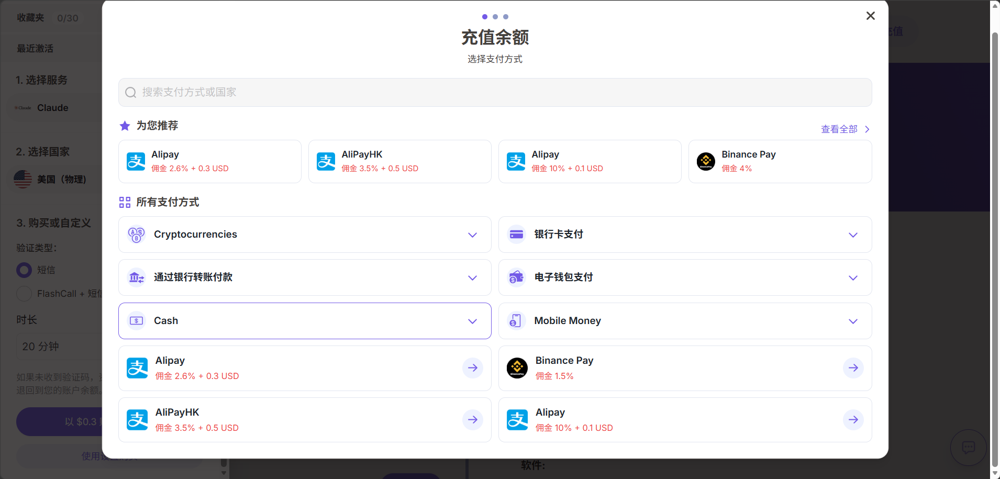

好了，以上就是全部内容啦，感谢观看。

验证完成后即可进入 Claude 对话页面，免费版可以直接使用，有更高需求的话也可以在官网升级 Pro 或 Max 订阅。

如果你对订阅Claude感兴趣的话，可以看我之前的文章。

相关阅读：[如何通过 WildAI 升级 Claude Pro / Max？2026 最新完整教程（附邀请码）](https://wildai.help/guides/claude-subscription/)

## 四、Claude注册常见问题（FAQ）

**Q1：Claude注册收不到邮件怎么办？**
 先检查垃圾邮件文件夹，确认邮箱地址输入无误，等待几分钟后再重新发送。

**Q2：Claude注册必须用手机号吗？**
 不一定，是否需要短信验证由系统判断。如果要求验证，可以使用文章介绍的接码服务

**Q3：Claude免费版和付费版有什么区别？**
 免费版可以体验 Claude 的核心功能，付费版提供更多用量和更多高级功能，具体以官网说明为准。

**Q4：为什么提示所在地区不支持？**
 说明当前地区不在 Claude 的服务范围内，可以关注官方支持地区列表的更新。

## 总结

以上就是 2026 年最新的 Claude注册教程。整个流程只需几分钟：进入官网、验证邮箱、填写信息、完成验证，就能开始用 Claude 提升效率。如果觉得有帮助，欢迎收藏和分享。

## 订阅与相关阅读

[前往 WildAI](https://bewild.ai/?code=1103)。注册时填写邀请码 **1103**，可享 **1 美元优惠**；适用范围和实付金额以当前结算页为准。该链接为推荐链接。请勿将密码、验证码或 Session 等登录凭据发到公开页面。

- [ChatGPT 注册教程](https://github.com/ai-subscription-guide/chatgpt-plus-guide/blob/main/guides/chatgpt-register.md)
- [ChatGPT 手机版下载教程](https://github.com/ai-subscription-guide/chatgpt-plus-guide/blob/main/guides/chatgpt-download-mobile.md)
- [ChatGPT 电脑版下载教程](https://github.com/ai-subscription-guide/chatgpt-plus-guide/blob/main/guides/chatgpt-download-desktop.md)
- [ChatGPT 订阅与支付指南](https://github.com/ai-subscription-guide/chatgpt-plus-guide)
